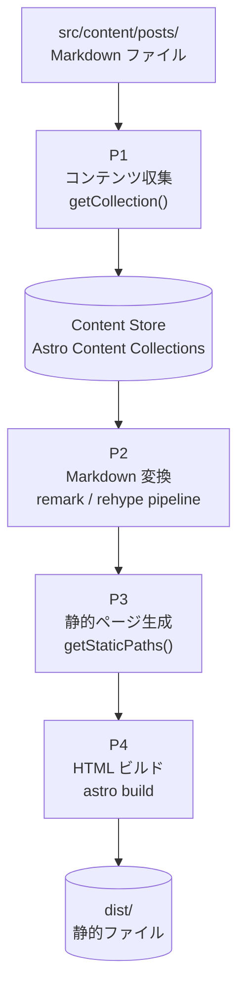
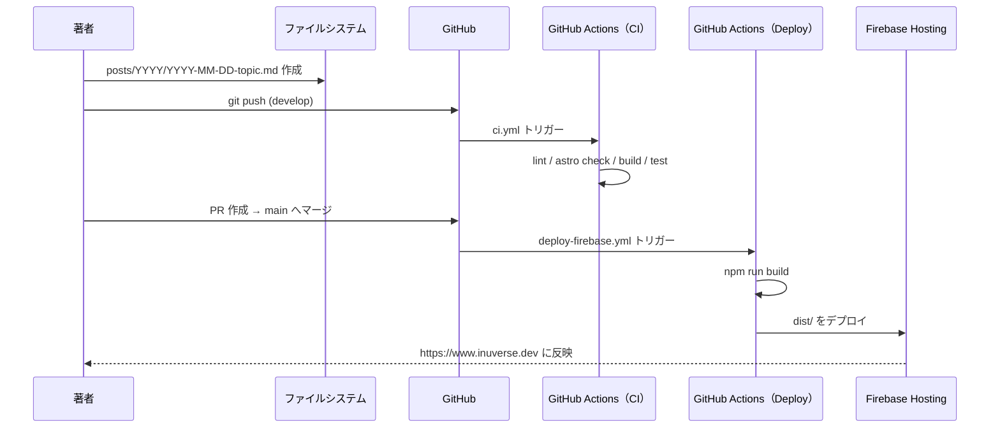
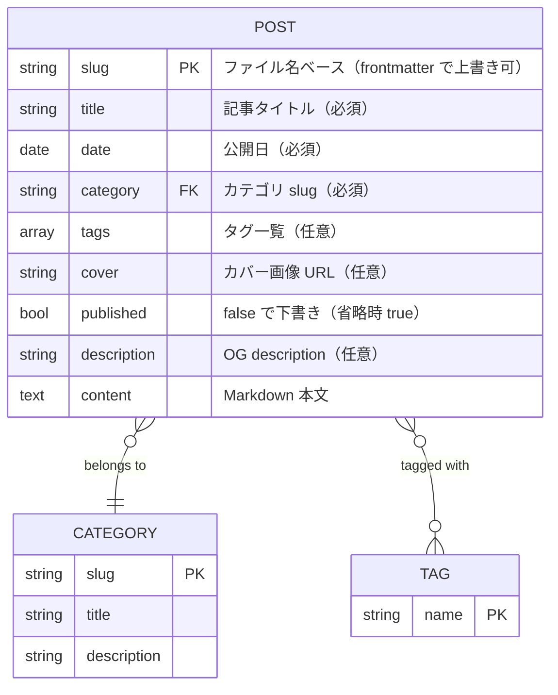

# データ設計書

## 1. データフロー図（DFD）

### レベル 0：コンテキスト図


---

### レベル 1：主要プロセス



---

### レベル 2：Markdown 変換パイプライン（P2 詳細）


---

### レベル 2：記事追加フロー（著者操作）



---

## 2. データモデル

### 2.1 Post（記事）



### 2.2 frontmatter サンプル

```yaml
---
slug: 2026-01-03-statistics-chapter2-prob   # サブディレクトリ移行時に明示
title: 統計学入門 第2章の問題について
date: '2026-01-03'
category: statistics-intro
tags:
  - 統計学
  - Kotlin
cover: https://example.com/image.jpg
published: true
description: 統計学入門の第2章を読んだメモです
---
```

---

## 3. ルーティングとスラッグの関係

| ファイルパス | slug | URL |
|------------|------|-----|
| `posts/2025/2025-11-14-rust.md` | `2025-11-14-rust`（frontmatter） | `/posts/2025-11-14-rust` |
| `posts/2026/2026-01-03-statistics-chapter2-prob.md` | `2026-01-03-statistics-chapter2-prob` | `/posts/2026-01-03-statistics-chapter2-prob` |

> `src/content.config.ts` の `glob` ローダーは、frontmatter に `slug` があればそれを `entry.id` に使う（なければファイルパスから生成し、サブディレクトリを含む）。ページは `entry.id` から URL を作るので、`slug` を明示すれば年別ディレクトリに置いても URL は変わらない。年別移行スクリプト（`scripts/migrate-posts-to-year-dirs.mjs`）がこの挿入を自動処理する。

---

## 4. カテゴリ定義

カテゴリは `src/constants/categories.ts` に静的定義する。記事は frontmatter の `category` に、ここの slug を必ず 1 つ書く。`src/content.config.ts` のスキーマが一覧にない slug や書き忘れを弾き、ビルドが止まる（エラーに使える slug が出る）。細かい分類はタグで行う。

| slug | タイトル | 入る記事 |
|------|---------|------|
| `statistics-intro` | 統計学入門を読んでみた | 「統計学入門 東京大学出版会」の読書メモと演習 |
| `physics` | 物理・宇宙論 | 一般相対論、宇宙論、解析力学、量子力学 |
| `math` | 数学・機械学習 | 確率・統計の計算、圏論、数値計算、機械学習 |
| `programming` | プログラミング | Kotlin、Rust などの言語、読みやすいコード、競技プログラミング、計算機の基礎 |
| `infra` | クラウド・インフラ | GKE、RabbitMQ、Prometheus、Docker、負荷検証 |
| `data-analysis` | データ解析 | 公開データを Python で調べた記事 |
| `misc` | 雑記 | 日記、論文メモ |
